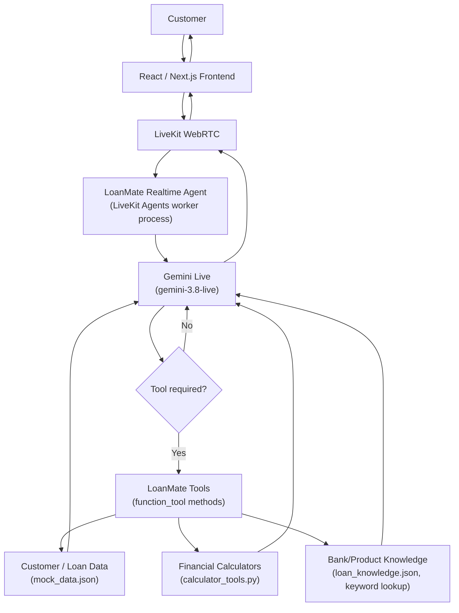
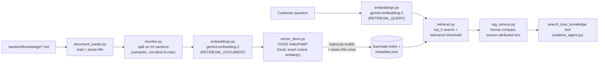
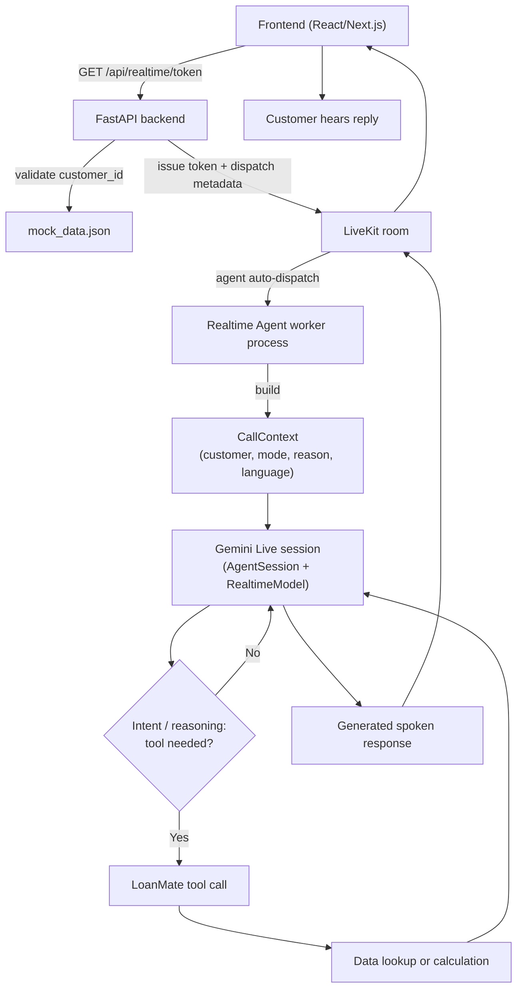

# LoanMate AI
## Realtime Conversational Voice Loan Assistant
### Complete Technical and Generative AI Documentation

**Prepared as:** Engineering + academic project documentation
**Document scope:** Complete system architecture, Generative AI techniques, Agentic AI design, testing, limitations, and viva preparation
**Verification basis:** Every claim in this document was cross-checked directly against the source code in this repository (`backend/`, `frontend/web/`, `tests/`, `requirements.txt`, `package.json`) at the time of writing. Where a number (latency, test count, tool count) is quoted, it comes from an actual measured run, not an estimate.

> **A note on academic honesty (methodology for this document):**
> This document strictly distinguishes between (A) what LoanMate's own code implements, and (B) what is internal behavior of the pretrained Gemini model that LoanMate calls over an API. Sentences like "LoanMate implements Agentic AI through tool calling" are accurate. Sentences like "we implemented a transformer" or "we implemented attention" would be false and are avoided throughout. Every "not implemented" claim (RAG, vector database, fine-tuning, Urdu support, guaranteed Indian accent, etc.) was confirmed by searching the codebase for the relevant library/pattern and finding none, not merely assumed.

---

## Table of Contents

1. Abstract
2. Introduction
3. Problem Statement
4. Objectives
5. System Overview
6. High-Level System Architecture
7. Technology Stack
8. Frontend Architecture
9. Backend Architecture
10. Customer Context
11. Inbound Call Flow
12. Outbound Call Flow
13. Agentic AI Architecture
14. Function / Tool Calling
15. Generative AI Techniques Used
16. Connection to Generative AI Course Syllabus
17. Transformer Concepts (Underlying Model Technology)
18. Language Support
19. Voice Technology
20. Realtime Communication
21. Legacy Voice Pipeline
22. Security and Data Handling
23. Testing
24. Latency Evaluation
25. Performance
26. Limitations
27. Future Enhancements
28. Why Agentic AI Is Appropriate for LoanMate
29. Complete Conversation Examples
30. Project Flow Diagram
31. Module-by-Module Documentation
32. API Documentation
33. Data Flow
34. Academic Learning Outcomes
35. Final Summary
36. Viva Questions and Answers

---

## 1. Abstract

LoanMate AI is a realtime, voice-first conversational assistant that lets a bank customer ask about their loan — EMI amount, outstanding balance, next payment date, loan status, and "what-if" calculations like prepayment or tenure comparison — by speaking naturally, in English, Hindi, or Hinglish (a natural mix of the two), instead of navigating a banking dashboard.

The system solves a narrow but real interaction problem: loan and EMI information is simple to state but tedious to find, because it is normally buried behind logins, menus, and dashboard widgets. LoanMate replaces that navigation with a spoken conversation. A customer can call in ("Call LoanMate") or the system can simulate the bank calling the customer ("Bank is Calling You") for an EMI reminder or a product update, and either way the interaction is a live, two-way voice call, not a form.

Generative AI is used as the conversational core: Google's Gemini Live model receives the customer's speech directly, understands the request, decides — on its own, per turn — whether it needs to call a backend function to get a real number (an example of **Agentic AI** via **function/tool calling**), and then speaks a natural-language reply, all within a single realtime audio session. The model never invents financial figures: every EMI, balance, or date the assistant states out loud comes from a deterministic Python function reading a customer record, and the model's only job is to decide when to call that function and how to phrase its result naturally. For questions that are *not* customer-specific — what documents a personal loan needs, what LoanMate's prepayment or foreclosure policy is, what happens if an EMI is missed — the same agent uses a **Retrieval-Augmented Generation (RAG)** tool: a small local knowledge base of demo policy/product documents is chunked, embedded with a Gemini embedding model, and searched by semantic similarity (via a local FAISS vector index) at query time, so those answers are grounded in real reference text instead of the model's own guesses.

Realtime behavior — the customer can interrupt the assistant mid-sentence and it stops and listens (barge-in), the assistant speaks first on an outbound call, and turn-taking feels like a phone call rather than a request/response chatbot — is achieved through LiveKit's WebRTC transport combined with Gemini's native audio-in/audio-out capability, not through a traditional record-then-transcribe pipeline.

This is an academic and engineering demonstration project. It uses mock customer/loan data, a browser-simulated outbound call (not real telephony), and free-tier API access, and it is explicitly **not** presented as a production banking system.

---

## 2. Introduction

### 2.1 Background

Conversational AI has moved through several generations: rule-based chatbots with hand-written decision trees, then retrieval/intent-classifier systems, and — since around 2020 — systems built on Large Language Models (LLMs), which generate fluent, context-aware text (and now audio) directly from a pretrained neural network rather than a fixed script. The growth of LLMs (GPT-family, Gemini-family, and others) has made it practical to build assistants that hold an open-ended conversation, understand phrasing variations, and switch languages mid-sentence — capabilities that are very difficult to hand-code.

Generative AI's entry into financial applications has generally taken the form of assistants that explain account information, answer FAQs, or guide a customer through a process in natural language, while keeping the actual financial computation in a deterministic, auditable system — because financial figures must be exactly correct, and an LLM by itself cannot guarantee that.

Voice specifically matters for banking/loan use cases because a large share of the target audience is more comfortable speaking than typing, especially in a mixed-language (Hindi/English) context, and because voice removes the need to learn a UI at all — the customer just asks.

### 2.2 Motivation for LoanMate

Loan and EMI information is high-frequency, low-complexity — "what's my EMI," "when's my next payment" — but the standard way to get it (login → find the loan section → find the right widget) is disproportionately heavy for the actual complexity of the question. LoanMate's motivation is to test whether a realtime voice agent, backed by an LLM for language understanding and deterministic tools for the actual numbers, can answer these questions as naturally as asking a human bank representative, in the customer's own mix of English and Hindi.

### 2.3 Objective of the project

Build and evaluate a working realtime voice assistant that combines a generative, agentic LLM (Gemini Live) with deterministic financial tools, over a real WebRTC transport (LiveKit), supporting both inbound and simulated-outbound calls, in English/Hindi/Hinglish, and to document precisely which parts of this are genuinely implemented versus which parts are capabilities of the underlying pretrained model.

**This project is a demonstration/academic application.** It is not connected to a real core banking system, does not use real customer data, does not perform real telephony, and should not be evaluated as production-ready banking software.

---

## 3. Problem Statement

Traditional loan-servicing interfaces (banking apps, net-banking portals, IVR menus) require a customer to:
- Log in and navigate to the correct section of a dashboard,
- Visually search for the specific figure they want among several unrelated widgets,
- Understand banking terminology (EMI, tenure, foreclosure, outstanding principal) well enough to locate the right screen, and
- Repeat this navigation separately for every follow-up question (e.g., checking EMI, then separately checking the next due date).

This is a mismatch between the simplicity of the underlying question ("what do I owe") and the effort required to answer it through a visual interface, particularly for users less comfortable with English-only banking UIs.

**Problem statement:** *Design and implement a conversational, voice-first interface that allows a bank customer to obtain loan-specific information and perform simple loan-related calculations through natural spoken dialogue — in English, Hindi, or Hinglish — without navigating a dashboard, while guaranteeing that every financial figure spoken to the customer is sourced from a deterministic calculation rather than generated by the language model itself.*

---

## 4. Objectives

1. Build a realtime conversational voice assistant (not a turn-based chatbot) using a WebRTC transport.
2. Allow customers to ask loan-related questions using natural spoken language.
3. Support English, Hindi, and Hinglish within the same conversation.
4. Retrieve customer-specific loan information (EMI, balance, due date, status, tenure, history) accurately.
5. Perform deterministic financial calculations (prepayment impact, tenure comparison, eligibility estimate).
6. Support **inbound** conversations (customer calls LoanMate).
7. Simulate **outbound** banking calls (LoanMate calls the customer) in the browser.
8. Support an **EMI reminder** outbound conversation mode.
9. Support a **product-update** outbound conversation mode.
10. Provide **interruption/barge-in** so the customer can interrupt the assistant naturally.
11. Use **Agentic AI** and **function/tool calling** so the model decides when backend data is needed, rather than hard-coding every branch.
12. Maintain **customer context** (identity, loan reference, call mode, reason, language) consistently for the duration of a call.
13. Produce **natural, conversational voice responses**, not robotic or overly formal text-to-speech.

---

## 5. System Overview

In plain terms, one inbound call works like this:

```
Customer
  ↓ speaks into browser microphone
Web browser (React app)
  ↓ WebRTC audio
LiveKit WebRTC (media transport)
  ↓ dispatches
LiveKit Agent (a Python worker process LoanMate runs)
  ↓ streams audio to
Gemini Live (Google's realtime multimodal model)
  ↓ understands the request; decides if a tool is needed
Tool selection (Gemini's own decision, not a separate classifier)
  ↓ if needed
LoanMate tools (plain Python functions)
  ↓ read
Customer/loan data (mock_data.json) or run a calculation
  ↓ tool returns a plain-language string
Gemini Live composes a spoken reply
  ↓ synthesized audio, streamed back
LiveKit WebRTC
  ↓
Web browser
  ↓
Customer hears the answer
```

**Component roles, in one line each:**
- **React/Next.js** — the only user-facing app for real calls; renders the voice orb, call state, mute/end controls.
- **LiveKit WebRTC** — carries live audio both directions with low latency; also carries the "listening / thinking / speaking" state as native events.
- **LiveKit Agent (worker process)** — a separate, always-running Python process that joins the call's room and holds the actual AI connection.
- **Gemini Live** — the generative model: understands speech, decides on tools, generates the spoken reply, all inside one continuous session.
- **LoanMate tools** — ordinary Python functions; the only place where an actual number is computed or looked up.
- **Customer/loan data** — a flat JSON file standing in for a real core-banking record.

---

## 6. High-Level System Architecture



This diagram matches the actual code path in `backend/voice_agent/realtime_agent.py`: the `LoanMateAgent` class defines the tools, `AgentSession` wraps the Gemini Live connection, and `RoomInputOptions`/LiveKit `Room` carry audio in both directions.

---

## 7. Technology Stack

Only technologies actually present in the repository (confirmed via `requirements.txt`, `frontend/web/package.json`, and imports in source files) are listed.

### Frontend (primary — `frontend/web/`)

| Technology | Version (from package.json) | Role |
|---|---|---|
| Next.js | 16.3.5 | React framework, App Router |
| React | 19.2.8 | UI rendering |
| TypeScript | ^5 | Static typing across the app |
| Tailwind CSS | ^4 | Styling |
| `@livekit/components-react` | ^2.9.24 | React hooks/components for LiveKit (`useVoiceAssistant`, `useTranscriptions`, `LiveKitRoom`) |
| `livekit-client` | ^2.22.3 | Underlying WebRTC client SDK |

### Backend

| Technology | Version (from requirements.txt) | Role |
|---|---|---|
| Python | 3.13 (dev environment) | Backend language |
| FastAPI | ≥0.115.0 | REST API framework |
| Uvicorn | ≥0.30.0 | ASGI server |
| Pydantic | ≥2.0 | Request/response validation |
| `livekit-agents[google]` | ~1.8 | LiveKit Agents worker framework + Gemini Live plugin |
| `livekit`, `livekit-api` | ≥1.1 (pulled in by `livekit-agents`) | LiveKit Python SDK for tokens/rooms |

### Generative AI

| Technology | Where used | Role |
|---|---|---|
| Gemini Live (`gemini-3.8-live`) | `backend/voice_agent/realtime_agent.py` via `livekit.plugins.google.realtime.RealtimeModel` | Primary conversational + voice model (realtime audio in/out, native tool calling) |
| Gemini text (`gemini-3.6-flash`) | `backend/services/llm_service.py` via `google-generativeai` (legacy) | Text-mode conversation and tool-result narration on the legacy path only |
| Gemini embeddings (`gemini-embedding-2`) | `backend/rag/embeddings.py` via `google.genai.Client` (current SDK) | Turns knowledge-base chunks and search queries into 768-dim vectors for RAG (§14.2) |
| Function/tool calling | `@function_tool()` decorator (LiveKit Agents SDK) | Lets Gemini invoke Python functions during a live conversation |

### Realtime Communication

| Technology | Role |
|---|---|
| LiveKit Cloud | Hosts the WebRTC rooms, handles media relay and agent dispatch |
| WebRTC | Underlying realtime audio transport standard used by LiveKit |
| LiveKit Agents (`AgentSession`) | Framework that wraps the Gemini Live session and exposes turn-taking/state |

### Retrieval (RAG)

| Technology | Role |
|---|---|
| FAISS (`faiss-cpu`) | Local, exact (flat) vector index over knowledge-base embeddings — `IndexFlatIP`, no ANN structure needed at this corpus size |
| `gemini-embedding-2` | Embedding model (see Generative AI table above) |

### Data

| Technology | Role |
|---|---|
| Flat JSON files (`mock_data.json`, `loan_knowledge.json`) | Demo customer/loan records and the legacy path's product/FAQ knowledge base — **no database**, no ORM, no migrations |
| Markdown knowledge base (`backend/knowledge/*.md`, 11 files) | The RAG knowledge base — loan products, policies, FAQs, required documents |
| FAISS index + JSON sidecar (`backend/rag/vector_store/`) | The built vector index (`loanmate.index`) and its metadata (`metadata.json`) — two local files, no external database |

### Legacy (explicitly not the primary path)

| Technology | Role | Status |
|---|---|---|
| Streamlit | Legacy demo frontend (`frontend/app.py`) | **Legacy** |
| faster-whisper | Legacy local speech-to-text | **Legacy** |
| edge-tts | Legacy text-to-speech | **Legacy** |

---

## 8. Frontend Architecture

The primary, production-facing frontend is `frontend/web/` (Next.js/React). It is **deliberately not a banking dashboard** — there is no account overview, no EMI cards, no transaction table. The entire interface is voice-first: a title, a voice orb, two call buttons, a language picker, and — once a call is active — call state, a short live transcript, mute, and end call.

### 8.1 Pages / structure

| File | Purpose |
|---|---|
| `app/page.tsx` | The single-page app's state machine: `home` → `connecting` / `outbound-calling` / `incoming-call` → `active-call` → `ended` |
| `app/layout.tsx` | Root HTML shell, font loading, LiveKit component styles |
| `app/lib/api.ts` | Typed API client — `fetchRealtimeToken()`, session-ID generation |
| `app/components/Home.tsx` | Title, voice orb, "Call LoanMate" / "Bank is Calling You" buttons, outbound-reason picker (EMI Reminder / Product Update), language pills (English / हिन्दी / Hinglish) |
| `app/components/OutboundFlow.tsx` | `OutboundCalling` (brief "LoanMate is calling…" transition) and `IncomingCall` (Decline/Accept card) |
| `app/components/ActiveCall.tsx` | Wraps `LiveKitRoom`; reads live state via `useVoiceAssistant()` and transcript via `useTranscriptions()`; renders Mute and End Call controls |
| `app/components/VoiceOrb.tsx` | The central animated orb, color/state-coded (idle, connecting, listening, thinking, speaking) |
| `app/components/LanguagePills.tsx` | English / Hindi / Hinglish selector |

### 8.2 Call state

Call state (`Connected`, `Listening…`, `Thinking…`, `Speaking…`) is **not** custom-built — it comes directly from LiveKit's own `useVoiceAssistant()` hook, which reflects the actual Gemini Live session state (`listening`/`thinking`/`speaking`/`connecting`/`disconnected`). This was a deliberate choice: earlier iterations of this project used a custom, hand-rolled state machine over a data channel for the legacy pipeline, but the current primary path uses the native mechanism LiveKit already provides, avoiding duplicated/inconsistent state.

### 8.3 Inbound flow (frontend side)

`Home` → click **Call LoanMate** → `page.tsx` requests a token (`call_mode=inbound`) → `ActiveCall` mounts, `LiveKitRoom` auto-publishes the microphone (`audio` prop, no push-to-talk button) and connects.

### 8.4 Outbound flow (frontend side)

`Home` → pick a reason pill (**EMI Reminder** or **Product Update**) → click **Bank is Calling You** → `OutboundCalling` (a short, honestly-paced "LoanMate is calling…" transition, not an instant jump) → `IncomingCall` card with **Decline**/**Accept** → **Accept** requests a token with `call_mode=outbound` and the selected `outbound_reason` → `ActiveCall` mounts exactly as in the inbound case.

### 8.5 Microphone, mute, end call

- Microphone: auto-published on connect (`LiveKitRoom audio` prop) — no push-to-talk button anywhere in the app.
- Mute: `localParticipant.setMicrophoneEnabled(!isMicrophoneEnabled)`, called directly from the React component — instant, no network round trip.
- End Call: disconnects the LiveKit room; `onDisconnected` callback moves the app to the `ended` screen.

### 8.6 Customer selection

There is no customer picker in the UI. The frontend always requests the single configured demo customer (`CUST001` — "Rajesh Kumar") by default; the backend is what actually validates whichever `customer_id` is requested (see §10, §22).

### 8.7 Why Next.js/React (not Streamlit) for the primary app

Streamlit is a Python data-app framework built around top-to-bottom script reruns; it can embed a LiveKit widget via custom HTML/JS, but it is not designed for a persistent WebRTC session with rich client-side state (mute toggles, live orb animation, transcript streaming) — the project's own history (documented in earlier iterations) shows workarounds becoming increasingly awkward on Streamlit for exactly this reason. Next.js/React, with LiveKit's official React SDK (`@livekit/components-react`), gives native hooks (`useVoiceAssistant`, `useTranscriptions`, `useLocalParticipant`) purpose-built for this. Streamlit (`frontend/app.py`) remains in the repository as the legacy/admin demo, not because it's a step backward, but because it was the original implementation and is left intact per project instruction not to delete legacy code.

---

## 9. Backend Architecture

There are **two separate running processes** on the backend for the primary voice path, and it is important not to conflate them.

### 9.1 FastAPI server (`backend/main.py`)

- Issues LiveKit access tokens (`GET /api/realtime/token`).
- Validates the requested `customer_id` against `mock_data.json` (`LoanService.get_customer_with_loans`) — returns HTTP 404 if unknown.
- Prepares **dispatch metadata** (`customer_id`, `call_mode`, `outbound_reason`, `language`) and embeds it in the LiveKit token's `RoomConfiguration`, so that when the browser joins the room, LiveKit Cloud automatically starts the correct agent worker in that room with that metadata attached.
- Exposes the remaining REST surface (`/api/loan/*` calculators, `/api/customer/*` lookup, `/api/apply/*`, and the legacy `/api/voice/*` and `/api/livekit/*` routes).
- **Never touches raw audio** for the primary path — it hands off entirely to LiveKit once the token is issued.

### 9.2 Realtime Agent worker (`backend/voice_agent/realtime_agent.py`)

A **separate, long-running Python process**, started independently (`python -m backend.voice_agent.realtime_agent dev`), that:
- Registers itself with LiveKit Cloud under a fixed name (`loanmate-realtime`) and only joins rooms that explicitly request it (via the dispatch metadata FastAPI attached to the token) — it does not auto-join arbitrary rooms.
- On dispatch, reads the job metadata, re-validates/resolves the customer record itself (`LoanService.get_customer_with_loans` again, independently of the FastAPI call), and builds a `CallContext` (§10).
- Constructs a `LoanMateAgent` (a subclass of LiveKit Agents' `Agent`) with the 10 bound tools (§14) and the system instructions built from `CallContext`.
- Opens an `AgentSession` backed by `RealtimeModel` (the Gemini Live connection) — this is the actual, single, continuous connection to Google's servers for the whole call.
- Receives the realtime conversation (audio in), lets Gemini decide on and execute tool calls, and streams the generated audio back into the LiveKit room.

**Why two processes?** FastAPI's request/response cycle is not designed to host a persistent per-call streaming connection; LiveKit Agents' architecture specifically requires a standing worker that LiveKit Cloud can dispatch into a room on demand. This is a structural requirement of the framework, not an arbitrary design choice.

### 9.3 Supporting services (backend, no AI)

| File | Role |
|---|---|
| `backend/services/loan_service.py` | Reads `mock_data.json` / `loan_knowledge.json`; no AI |
| `backend/services/livekit_service.py` | Builds/validates LiveKit tokens using `LIVEKIT_API_KEY`/`SECRET` |
| `backend/tools/loan_tools.py`, `backend/tools/calculator_tools.py` | Pure Python functions — the deterministic layer (§14) |

---

## 10. Customer Context

`backend/voice_agent/call_context.py` defines a single, frozen dataclass that is the one place a call's identity and purpose are represented:

```python
@dataclass(frozen=True)
class CallContext:
    customer_id: str
    customer_name: str
    loan_id: str | None
    call_mode: Literal["inbound", "outbound"]
    outbound_reason: Literal["product_update", "emi_reminder"] | None
    language: Literal["english", "hindi", "hinglish"]
```

It also exposes two derived properties used elsewhere: `gemini_language_code` (maps `"english"`→`en-IN`, `"hindi"`→`hi-IN`, `"hinglish"`→`None`) and `first_name` (for a natural "Hi Rajesh" rather than "Hi Rajesh Kumar" in greetings).

**Why this matters:** `CallContext` is built server-side, once per call, from data the backend itself resolved (`LoanService.get_customer_with_loans(customer_id)`) — never from anything the browser directly states about who the customer is. It is then rendered into the model's system prompt as a literal block:

```
CUSTOMER CONTEXT:
Customer name: Rajesh Kumar
Customer ID: CUST001
Loan ID: LN10001
```

This means the model does not have to guess, ask for, or hallucinate the customer's identity — it is simply told, once, at the start of the session. This is directly testable:

> **Customer:** "What is my name?"
> **Agent:** "Your name is Rajesh Kumar."

**Security principle (verified in code):** the browser can only request a call for a given `customer_id` value; it cannot supply a `customer_name` or `loan_id` directly. `backend/routes/realtime.py` calls `LoanService.get_customer_with_loans(customer_id)` and returns HTTP 404 if that ID doesn't exist in `mock_data.json` — only the resulting, backend-resolved record is ever used to build `CallContext`.

---

## 11. Inbound Call Flow

```
User clicks "Call LoanMate"
        ↓
Frontend requests GET /api/realtime/token (call_mode=inbound)
        ↓
Backend validates customer_id against mock_data.json
        ↓
Backend issues LiveKit token + room-config agent dispatch metadata
        ↓
Browser connects to LiveKit room, mic auto-published
        ↓
LiveKit Cloud dispatches the "loanmate-realtime" worker into the room
        ↓
Worker builds CallContext, starts AgentSession
        ↓
Gemini Live session opens; agent speaks a short natural greeting FIRST
        ↓
Customer speaks
        ↓
Gemini Live interprets the request (native ASR + reasoning, no separate STT step)
        ↓
Tool called if the request needs real customer data
        ↓
Response generated by Gemini Live and spoken back
        ↓
Voice returned to the customer over LiveKit
```

**Verified example (from live testing against the real pipeline, this session):**

> **Agent:** "Hi, you've reached LoanMate. How can I help you today?"
> **Customer:** "Mera EMI kitna hai?"
> **Agent:** "Aapka monthly EMI ₹31,500 hai."

Note that even for an *inbound* call, the agent still speaks first — a short, non-pitching greeting — before listening; this was an explicit design requirement (§12 contrasts this with the outbound case, where the opening line additionally carries a reason).

---

## 12. Outbound Call Flow

**This is a browser-based simulation, not real telephony.** There is no PSTN integration, no phone number, no SIP trunk, and no Twilio (Twilio was explicitly removed from this project in an earlier iteration, per the git history). "Bank is Calling You" is a UI-simulated incoming call inside the same web app, using the same LiveKit infrastructure as the inbound path — it demonstrates the *conversational* pattern of an outbound bank call, not a real calling capability.

```
User selects an outbound reason (EMI Reminder or Product Update)
        ↓
User clicks "Bank is Calling You"
        ↓
"LoanMate is calling…" transition screen (~1.3s, deliberately paced, not instant)
        ↓
"Incoming Call" card — Decline / Accept
        ↓
User clicks Accept
        ↓
Frontend requests a token with call_mode=outbound and the chosen outbound_reason
        ↓
Same dispatch/CallContext/AgentSession flow as inbound
        ↓
Agent speaks FIRST — the opening line is reason-specific, generated before any user audio
        ↓
Conversation continues normally from there
```

### 12.1 `product_update`

**Verified example:**
> **Agent:** "Hi Rajesh, this is LoanMate calling from your bank. Is this a good time for a quick update? We have some information about a loan product that may be relevant to you."

### 12.2 `emi_reminder`

**Verified example:**
> **Agent:** "Hi Rajesh, this is LoanMate calling from your bank. I'm calling with a quick reminder about your upcoming EMI payment. Is now a good time?"

In both cases, once the customer responds, the conversation proceeds as a normal LoanMate conversation — e.g., if asked "how much is it?" during an EMI-reminder call, the agent calls `get_emi()` rather than inventing a figure (verified: "Your EMI amount is ₹31,500.").

---

## 13. Agentic AI Architecture

This is the most important conceptual section of this document: **why LoanMate is an AI agent, not simply a chatbot wrapped around an LLM.**

### 13.1 Simple chatbot pattern

```
User → LLM → Answer
```
A plain chatbot sends the user's message (plus maybe some static context) to an LLM and speaks whatever text comes back. It has no way to guarantee the answer is *correct* — if asked "what's my EMI," it can only guess or hallucinate a plausible-sounding number, because it has no mechanism to go look up a real one.

### 13.2 LoanMate's agent pattern

```
User
  ↓
LLM / Agent (Gemini Live inside AgentSession)
  ↓
Understand intent  (native language understanding — no separate NLU model)
  ↓
Decide whether a tool is required   ← this decision is made by the model itself
  ↓
Call the appropriate tool (a real Python function)
  ↓
Receive the tool's result (a real number/string)
  ↓
Generate a natural-language response using that real result
  ↓
Speak the response to the customer
  ↓
(if interrupted, stop and restart this loop from "Understand intent")
```

### 13.3 Mapping to the standard agent concept (perception → reasoning → action → observation → response)

| Agent concept | LoanMate implementation |
|---|---|
| **Perception / input** | Live audio stream from the customer, ingested directly by Gemini Live over the LiveKit WebRTC connection — no separate speech-to-text step in this path |
| **Reasoning / decision** | Gemini Live's own function-calling decision: given the conversation so far and the tool schemas it was given (derived from each tool's docstring), it decides which tool (if any) applies |
| **Tool / action** | One of the 10 `@function_tool()` methods on `LoanMateAgent` (`backend/voice_agent/realtime_agent.py`) executes — plain Python, e.g. `loan_tools.get_emi(customer_context)` |
| **Observation / result** | The tool's return value (a short string, e.g. `"The customer's current monthly EMI is ₹31,500."`) is fed back into the model's context |
| **Response** | Gemini Live generates and speaks a natural phrasing of that observation |

This loop repeats every turn, including after an interruption — a genuinely agentic, multi-step decision process, not a single prompt-to-answer mapping.

---

## 14. Function / Tool Calling

All 10 tools are defined as `@function_tool()`-decorated async methods on the `LoanMateAgent` class in `backend/voice_agent/realtime_agent.py`. 9 deterministic financial/loan tools plus **1 retrieval tool**:

| Tool | Purpose | Example question |
|---|---|---|
| `get_emi` | Returns the customer's current monthly EMI | "What is my EMI?" |
| `get_outstanding_balance` | Returns the remaining loan principal | "What is my outstanding balance?" |
| `get_next_payment` | Returns the next EMI due date | "When is my next EMI?" |
| `get_loan_status` | Returns loan status (Active/Closed/Overdue) | "What is my loan status?" |
| `get_remaining_tenure` | Returns months remaining on the loan | "How many EMIs are left?" |
| `get_payment_history` | Returns the current EMI schedule (no transaction-level history in this demo dataset — the tool says so honestly rather than fabricating past payments) | "Show me my payment history." |
| `calculate_prepayment` | Computes new balance/EMI after a lump-sum prepayment | "If I prepay 2 lakh, what happens?" |
| `compare_tenures` | Computes EMI/interest across multiple tenure options | "Compare 5 years and 10 years." |
| `calculate_loan_eligibility` | Rough FOIR-based affordability estimate for a *new* loan (explicitly labeled a demo estimate, not real underwriting) | "How much loan can I afford?" |
| **`search_loan_knowledge`** *(10th tool — a retrieval tool, NOT a financial calculator)* | Semantic (embedding-based) search over LoanMate's demo knowledge base — loan products, policies, FAQs, required documents | "What documents do I need for a personal loan?" / "What is foreclosure?" |

The first 6 tools **retrieve** existing customer/loan data (`backend/tools/loan_tools.py`); `calculate_prepayment`, `compare_tenures`, and `calculate_loan_eligibility` **compute** a result (`backend/tools/calculator_tools.py`) using plain arithmetic (a standard reducing-balance EMI formula) — no model involvement in the arithmetic itself. `search_loan_knowledge` is categorically different from all 9 — it never touches this customer's account data at all; it only searches a small, general, read-only knowledge base (§14.2).

### 14.1 Why deterministic tools matter in a financial application

**Verified example:**
> **User:** "What is my outstanding balance?"
> **Agent → tool call:** `get_outstanding_balance()`
> **Tool → returns:** `"The outstanding balance is ₹2,870,000."`
> **Agent (spoken):** "Aapka outstanding balance ₹28.7 lakh hai."

The LLM's role here is strictly to *decide to call the tool* and *phrase* its exact result — it never computes the ₹2,870,000 figure itself. This is the project's core anti-hallucination guarantee: a generative model is fluent but not reliably arithmetically correct or factually grounded in *this specific customer's* private data, so every customer-specific number is required — by explicit system-prompt instruction and by the tool-calling architecture itself — to originate from a plain Python function reading a real (here, mock) data record.

### 14.2 Retrieval-Augmented Generation (RAG) Implementation

**RAG is implemented in this project as of this revision.** It is additive: nothing about LiveKit, Gemini Live, `AgentSession`, customer context, inbound/outbound modes, barge-in, or the 9 financial tools above was changed to add it. It adds exactly one new tool, `search_loan_knowledge`, backed by a real, working retrieval pipeline over a local knowledge base.

**Why RAG was added:** the 9 financial tools only know about *this customer's own account*. They have no way to answer "what documents do I need for a personal loan," "what is your prepayment policy," or "what happens if I miss an EMI" — general LoanMate product/policy questions that are true for every customer, not looked up from one customer's record. RAG closes that gap by giving the model a way to search real reference text instead of guessing.

**Knowledge base (`backend/knowledge/`):** 11 Markdown documents, written specifically for this project and explicitly labeled as fictional demo content of "LoanMate Bank" (not a real bank's policy), organized into four folders matching the required structure:

```
backend/knowledge/
    loan_products/   personal_loan.md, home_loan.md, education_loan.md
    policies/        prepayment_policy.md, foreclosure_policy.md,
                     missed_emi_policy.md, eligibility_policy.md
    faq/             loan_faq.md, emi_faq.md, general_banking_faq.md
    documents/       required_documents.md
```

**Pipeline (`backend/rag/`):**



- **Document loading** (`document_loader.py`): recursively loads every `.md` file, tagging each with `document_type` (parent folder name) and `topic` (filename).
- **Chunking** (`chunker.py`): splits each document on its `##` section headings (Overview, Eligibility Criteria, Charges, Frequently Asked Questions, etc.) — a semantic split, not a blind fixed-character split — producing **75 chunks** from the 11 documents. Each chunk carries full metadata: `source_file`, `document_type`, `topic`, `section`, `chunk_id`.
- **Embedding model**: **`gemini-embedding-2`**, confirmed available for this project's real API key via a live `models.list()` call before being adopted (not assumed) — accessed through the current `google-genai` SDK (`google.genai.Client`), not the deprecated `google-generativeai` SDK the legacy text path still uses. Output is truncated to **768 dimensions** (a supported Matryoshka-style truncation of the model's native 3072-dim output, also confirmed with a real API call). Chunks are embedded with `task_type="RETRIEVAL_DOCUMENT"`; queries at search time are embedded with `task_type="RETRIEVAL_QUERY"` — Gemini's documented mechanism for asymmetric retrieval embeddings.
- **Vector store** (`vector_store.py`): **FAISS**, specifically `IndexFlatIP` (flat, exact/brute-force inner-product search) over L2-normalized vectors, which makes the inner product equivalent to cosine similarity. This is a genuine FAISS vector index, not a hand-rolled substitute — but it is an **exact** index, not an approximate/ANN index like HNSW. An ANN structure was deliberately not used: at 75 chunks, exact search is already sub-millisecond, so approximating it would only trade accuracy for no real speed benefit at this corpus size. Two local files are produced: `backend/rag/vector_store/loanmate.index` (the FAISS index) and `metadata.json` (chunk text + metadata, row-aligned with the index) — no external database, no paid service, no Redis/Elasticsearch.
- **Ingestion** (`backend/rag/ingest.py`, run via `python -m backend.rag.ingest`): the one-time/offline step that loads, chunks, embeds, and saves the index. **The running application never rebuilds the index itself** — FastAPI and the realtime worker only ever load the pre-built `loanmate.index`/`metadata.json` files, so normal operation makes zero embedding API calls. Re-run this command whenever a file under `backend/knowledge/` changes.
- **Retrieval** (`retriever.py`): embeds the query, searches the FAISS index for the top-k (default 3) most similar chunks, and **filters out anything below a relevance threshold** (`MIN_RELEVANCE_SCORE = 0.65`). This threshold was not guessed — it was derived by embedding a set of on-topic and clearly off-topic test queries against the real, built index and inspecting the actual score distribution (see §24 for the measured numbers). If nothing clears the threshold, the retriever returns nothing, and `rag_service.py` turns that into an explicit `"No sufficiently relevant information was found in the LoanMate knowledge base."` message — the model is never left to fill that gap with an invented answer.
- **The `search_loan_knowledge` tool** (`realtime_agent.py`): the only thing the realtime agent actually calls. It never returns raw embedding vectors or whole documents to the model — only the matched chunk text plus a `[source: file.md — Section Name]` attribution line per result, which stays available in logs/transcripts for debugging and academic demonstration even though the agent doesn't necessarily speak the filename aloud.

**Source attribution — verified real example**, from a live test against the actual pipeline:
```
[TOOL] search_loan_knowledge -> [source: required_documents.md — Section: Personal Loan Documents]
LoanMate Bank (Demo) — Required Documents by Loan Type — Section: Personal Loan Documents
Salaried applicants: KYC documents (Aadhaar / PAN / Passport / Voter ID)...
```

### 14.3 Tool Routing — Customer Facts vs. Knowledge Base

The system prompt (`backend/voice_agent/prompts.py`) draws an explicit line the model must follow:

- **Customer-specific facts** (EMI, balance, due date, status, tenure, history, or any prepayment/tenure/eligibility calculation) → one of the 9 deterministic tools. `search_loan_knowledge` is explicitly forbidden from being used for these.
- **Knowledge/policy/product questions** (not specific to this one customer) → `search_loan_knowledge`.

**Verified routing, from live tests against the real pipeline:**

| Question | Tool(s) called |
|---|---|
| "Mera EMI kitna hai?" | `get_emi` |
| "What is my outstanding balance?" | (routes to the deterministic tool — verified in earlier testing, unaffected by this change) |
| "What documents do I need for a personal loan?" | `search_loan_knowledge` → `required_documents.md` |
| "Prepayment karne pe koi charges hain kya?" (Hinglish) | `search_loan_knowledge` → `prepayment_policy.md` |
| "Agar main do lakh prepay karun toh kya hoga, aur kya koi charges hain?" | `calculate_prepayment(prepayment_amount=200000)` **and** `search_loan_knowledge` (hybrid — see §14.4) |

### 14.4 Hybrid Tool + RAG Behavior

The agent can and does use a deterministic tool and RAG together in one conversation to answer a compound question. Verified live: asked *"Agar main do lakh prepay karun toh kya hoga, aur kya koi charges hain?"* ("if I prepay two lakh what happens, and are there any charges"), the agent called **`calculate_prepayment(prepayment_amount=200000)`** for the numeric impact and drew on a **`search_loan_knowledge`** result already retrieved earlier in the same conversation (the prepayment-charges policy, 2–5% of outstanding principal) to answer the charges half — combining both into one natural spoken answer rather than treating them as separate questions. The calculation was never estimated by the model itself, and the policy figure was never invented — both halves trace back to a real tool call.

---

## 15. Generative AI Techniques Used

### 15.1 Large Language Models
Gemini (specifically `gemini-3.8-live` for the realtime path, `gemini-3.6-flash` for the legacy text path) is the LLM used throughout. Both are pretrained, general-purpose language models accessed via API — LoanMate does not train or fine-tune any language model.

### 15.2 Generative AI
Every spoken reply the customer hears is dynamically generated natural language, not a pre-written template selected by a lookup (with one narrow, explicitly non-AI exception: the legacy path's hand-written bilingual templates for known tool results, used specifically to *avoid* an LLM call — see §21).

### 15.3 Prompt Engineering
`backend/voice_agent/prompts.py` builds the system instructions given to Gemini Live: persona and tone ("warm, professional Indian bank representative... not robotic, not salesy," with concrete good/bad phrasing examples), the literal `CUSTOMER CONTEXT` block, identity-handling rules, the tools-vs-general-knowledge rule, an explicit no-Urdu rule, Hinglish vocabulary guidance, and the barge-in rule. Separate builder functions (`build_inbound_instructions`, `build_outbound_instructions`) generate the mode-specific opening line.

### 15.4 Agentic AI
The model — not a hand-coded rule — decides per turn whether a customer's question requires a tool call, and which one, based on the tool schemas and the conversation so far (§13).

### 15.5 Function / Tool Calling
Gemini Live natively invokes the 10 Python functions bound to `LoanMateAgent` (§14) via the LiveKit Agents SDK's `@function_tool()` mechanism, which parses each function's docstring into a JSON schema at startup.

### 15.6 Realtime Conversational AI
Gemini Live receives and produces audio continuously over one WebSocket session (via the LiveKit plugin), rather than the traditional "record utterance → transcribe → generate text → synthesize speech" cascade — this is what makes turn-taking and interruption feel like a phone call rather than a back-and-forth chat (§20).

### 15.7 Multilingual / Code-Switched Conversation
English, Hindi, and Hinglish are all understood and generated by the same model within the same session, without a separate translation step (§18).

### 15.8 Context-Aware Generation
The `CUSTOMER CONTEXT` block (§10) is injected into the system prompt once per call, so every generated response is implicitly grounded in who the customer is, without needing to re-ask.

### 15.9 Speech-based Generative Interaction
Input is live human speech; output is synthesized speech generated by the same model — not text converted to speech by a separate, disconnected TTS engine (that pattern is the *legacy* path, §21).

### 15.10 Barge-in / Interruption
Verified directly in live testing: when the customer starts speaking while the agent is mid-sentence, the agent's audio audibly stops mid-word and it answers the new question instead of finishing the old sentence. Example captured during testing: the agent was mid-way through *"...toh aapka naya outstanding"* when the customer said "Wait, outstanding balance kitna hai?" — the agent stopped and correctly answered the new question. This is handled by Gemini Live's own native turn-detection/interruption behavior as exposed through LiveKit Agents' `AgentSession`, not a custom voice-activity detector (that pattern — custom RMS-based VAD — exists only in the *legacy* path, §21).

---

## 16. Connection to Generative AI Course Syllabus

| Lecture | Topic | LoanMate Usage | Status |
|---|---|---|---|
| 1 | Introduction to Generative Models | Gemini is a generative model; every spoken reply is generated, not retrieved from a fixed set | **DIRECTLY USED** |
| 2 | Applications of LLMs for Vision and Language | LoanMate applies an LLM to a language (voice conversation) application; no vision component is used | **PARTIALLY RELATED** |
| 3 | Introduction to LLM; traditional LMs vs LLMs | Gemini is used as-is via API; LoanMate does not build or compare language models | **DIRECTLY USED** (as consumer of an LLM) |
| 4 | Autoregressive models | Gemini generates text/audio autoregressively internally | **USED INTERNALLY BY PRETRAINED MODEL** |
| 5 | Attention, multi-head attention, self-attention | Internal to Gemini's transformer architecture; not implemented or accessed by LoanMate's code | **USED INTERNALLY BY PRETRAINED MODEL** |
| 6 | Positional embeddings, sinusoidal encoding, RoPE | Internal to Gemini; LoanMate has no positional-encoding code | **USED INTERNALLY BY PRETRAINED MODEL** |
| 7 | Encoder-only model: BERT | Not used anywhere in this project | **NOT USED** |
| 8 | Decoder-only / GPT architecture | Gemini is understood to be a decoder-style generative transformer; LoanMate does not implement this architecture itself | **USED INTERNALLY BY PRETRAINED MODEL** |
| 9 | GPT-2, GPT-3 | Not used — LoanMate uses Gemini exclusively, no OpenAI models | **NOT USED** |
| 10 | Encoder-decoder / BART | Not used | **NOT USED** |
| 11 | LLM Frameworks | `google-generativeai` SDK and `livekit-agents` (with its Google Gemini Live plugin) are the LLM-facing frameworks actually used | **DIRECTLY USED** |
| 13 | Vector databases | **Implemented** — FAISS (`IndexFlatIP`), a genuine vector-search library, stores and searches the 75-chunk knowledge-base index (§14.2). Marked directly used specifically because a real vector index exists and is queried by cosine similarity; it should still be described precisely as a small, local, **flat/exact** index, not an approximate/ANN structure like HNSW (that remains a separate, unimplemented topic — see Lecture 15) | **DIRECTLY USED** |
| 14 | Vector embeddings / semantic similarity | **Implemented** — every knowledge-base chunk and every search query is embedded with `gemini-embedding-2` (768-dim), and retrieval ranks chunks by cosine similarity to the query embedding, not by keyword overlap (§14.2) | **DIRECTLY USED** |
| 15 | HNSW and LSH | Not used — the FAISS index is a flat/exact index (`IndexFlatIP`), not an approximate-nearest-neighbour structure; at 75 chunks, exact search is already sub-millisecond, so an ANN index would trade accuracy for no real benefit at this scale | **NOT USED** |
| 16 | RAG | **Implemented** — a full retrieve-then-generate pipeline: the knowledge base is chunked and embedded offline, a customer question is embedded and matched against the index at query time, and the retrieved text is handed to Gemini Live (via the `search_loan_knowledge` tool) to ground its spoken answer, with an explicit relevance threshold preventing the model from answering when nothing relevant is found (§14.2, §16) | **DIRECTLY USED** |
| 17 | Fine-tuning / LoRA / QLoRA | Gemini is used purely via API, unmodified; no fine-tuning, adapter, or weight-update step exists in this project | **NOT USED** |
| 18 | Vision Transformers / LVM | No image or video input/processing anywhere in LoanMate | **NOT USED** |
| 19 | CLIP | Not used | **NOT USED** |
| 20–21 | Diffusion models / fundamentals | Not used — no image/audio diffusion generation | **NOT USED** |
| 22 | Generate data from noise | Not used | **NOT USED** |
| 23 | Comparison with GAN | Not used — no GAN anywhere in the project | **NOT USED** |
| 24 | Training DDPM | Not used | **NOT USED** |
| 25 | LLM evaluation | Manual and scripted evaluation was performed: simulated conversation tests, tool-call correctness checks, latency measurement, and a 6-voice comparison evaluation (§23, §24) | **DIRECTLY USED** (informal/manual evaluation, not a formal academic benchmark suite) |
| 28 | Definition and concept of Agentic AI | LoanMate's tool-calling architecture is a direct, working example of an AI agent (§13) | **DIRECTLY USED** |
| 29 | LLMs vs AI Agents; agent components | LoanMate explicitly demonstrates the perception → reasoning → action → observation → response loop (§13.3) | **DIRECTLY USED** |
| 30 | Ethical/practical considerations in Agentic AI | Discussed in §22 and §26 — data validation, no arbitrary client-supplied identity, mock data only, no real financial consequence | **DIRECTLY USED** (as a design consideration, not a formal ethics framework) |

**Summary read of this table:** every lecture topic describing *how to build or train a generative model* (Lectures 4–10, 17–24) maps to **internal Gemini technology that LoanMate consumes but does not implement**. Every lecture topic describing *how to use, orchestrate, or evaluate* a generative model (Lectures 1, 3, 11, 25, 28–30) maps to something LoanMate **directly implements**. The retrieval/vector-search cluster (Lectures 13, 14, 16) is now **directly implemented** via the RAG pipeline in §14.2 — a real FAISS vector index, real Gemini embeddings, and a real retrieve-then-generate flow, distinct from the approximate-nearest-neighbour techniques (Lecture 15) that remain unimplemented.

---

## 17. Transformer Concepts (Underlying Model Technology)

Conceptually, a transformer-based generative model like Gemini processes a request as:

```
Input (text/audio)
  ↓
Token / representation processing
  ↓
Transformer layers
  ↓
Attention  (self-attention, multi-head attention — relates each part of the input to every other part)
  ↓
Contextual representation
  ↓
Generation  (autoregressive — one token/audio-frame at a time, conditioned on everything generated so far)
```

**This entire pipeline is internal to the pretrained Gemini model, run on Google's infrastructure.** LoanMate's code sends audio/text to this model over an API and receives generated audio/text back; it does not implement, train, fine-tune, or have access to the attention layers, positional encodings, or autoregressive decoding loop themselves.

> **Explicit statement, per the academic-honesty requirement of this document:** self-attention, multi-head attention, positional encoding (sinusoidal or RoPE), and autoregressive generation are part of the underlying pretrained Gemini architecture. They are **not implemented from scratch in LoanMate**, and no code in this repository defines or trains a transformer layer, attention head, or positional embedding.

---

## 18. Language Support

LoanMate supports exactly three conversational modes: **English**, **Hindi**, and **Hinglish** (natural code-mixing of the two). No other language, and specifically **no Urdu**, is supported.

- `en-IN` and `hi-IN` (BCP-47 locale codes) are passed to Gemini Live via the `RealtimeModel(language=...)` parameter when the customer/UI selects English or Hindi respectively — confirmed working against the live API in this project's own testing.
- For **Hinglish**, the language code is deliberately left unset (`None`) rather than pinned to either locale. This is a specific implementation choice: pinning a single BCP-47 code was found to work against the model's natural tendency to freely mix English and Hindi within one sentence, so Hinglish is instead handled by leaving language auto-detected and relying on explicit system-prompt instructions ("keep common banking words in English... don't suddenly switch into extremely formal Hindi").
- **Urdu is explicitly excluded.** The system prompt states directly that Urdu script/vocabulary is not supported, and there is no Urdu-specific code, transliteration, or intent-mapping anywhere in the repository. (Note: an unrelated internal diagnostic tool used during development — `faster-whisper`, used only to double-check pronunciation clarity of test audio, not part of the production path — occasionally rendered Hindi speech back in Perso-Arabic/Nastaliq script due to its own model behavior; this is a known quirk of that offline tool and is unrelated to, and does not indicate, any Urdu support in LoanMate's actual conversational pipeline, which was separately confirmed to consistently produce/read proper Devanagari Hindi.)

**Examples handled correctly (verified in live testing):**
- "Mera EMI kitna hai?" → "Aapka monthly EMI ₹31,500 hai."
- "Mera loan kitna baaki hai?" → understood as an outstanding-balance question
- "Next EMI kab hai?" → "Aapka next EMI payment September 5, 2026 ko due hai."
- "Agar main do lakh prepay karun toh kya hoga?" → correctly parsed "do lakh" (spoken Hindi for 2 lakh) as ₹200,000 and called `calculate_prepayment`

---

## 19. Voice Technology

```
Customer microphone
      ↓  WebRTC
LiveKit
      ↓
Gemini Live  (native speech understanding AND native speech generation — one model, one connection)
      ↓  WebRTC
LiveKit
      ↓
Customer speaker
```

There is no separate STT model and no separate TTS engine in this path — Gemini Live both *understands* the incoming audio and *generates* the outgoing audio itself.

### 19.1 Indian voice — documented honestly

- `language=en-IN` / `hi-IN` is configured and does improve regional-language behavior (pronunciation of Hindi terms, numbers, locale-appropriate phrasing).
- **This is a language/locale setting, not a voice-accent guarantee.** Gemini Live's selectable voice identities (e.g., "Puck," the voice currently configured) are generic named voices with no documented Indian-accent variant — locale and voice identity are two separate parameters.
- This project ran a structured, 6-voice comparison (Puck, Kore, Charon, Aoede, Leda, Orus) generating real audio samples for the same test sentences in English/Hindi/Hinglish, specifically to evaluate this question empirically rather than assume it. The samples and results are stored in `voice_evaluation/` in this repository. **No automated judgment of "how Indian" a voice sounds was made** — that is a human perceptual judgment; the comparison samples exist for a human listener to evaluate.
- **Google Cloud Text-to-Speech** (which does offer dedicated `en-IN`/`hi-IN` neural voices) was prototyped in isolation (`backend/voice_agent/prototype_cloud_tts.py`) as a possible future alternative voice source, but this prototype is confirmed **blocked** in the current environment — it requires separate Google Cloud Application Default Credentials, which are not configured (verified by an actual failed API call, `DefaultCredentialsError`, not just a missing environment variable check). It has **not** been integrated into production and does not affect the current voice pipeline.
- **Conclusion, stated plainly:** LoanMate does not currently guarantee an Indian-accented voice. It configures Indian language locale behavior, which is a real and verified improvement to language handling, but accent is a separate, currently unresolved question, documented as a limitation (§26) and a future enhancement (§27).

---

## 20. Realtime Communication

- **WebRTC** — the underlying open standard for realtime audio/video transport used throughout the primary path.
- **LiveKit** — the managed WebRTC infrastructure (LiveKit Cloud) this project builds on; handles room creation, media relay, and — critically — **agent dispatch** (automatically starting the correct backend worker process in a room based on token metadata).
- **`AgentSession`** (LiveKit Agents SDK) — the object that wraps the Gemini Live connection and exposes conversation state (listening/thinking/speaking) as events the frontend consumes natively.
- **Realtime audio** — audio is streamed continuously in both directions; there is no "press to talk, then wait" step.
- **Turn detection / interruption / barge-in** — handled by Gemini Live's own native behavior inside the realtime session, not a custom algorithm in this path (contrast with the legacy path, §21, which does use a custom detector).
- **Microphone publishing/subscription** — the browser publishes its microphone track on connect; the agent worker subscribes to it; the agent's generated audio is published back as its own track, which the browser subscribes to and plays via `RoomAudioRenderer`.

**Why realtime architecture was chosen over the old batch pipeline:** the legacy pipeline (§21) has to wait for the caller to finish speaking, detect silence, transcribe the whole utterance, run a separate LLM call, then synthesize and stream the reply — a strictly sequential chain of four distinct systems, each adding latency. The realtime architecture collapses recognition, reasoning, and synthesis into one continuous model connection, which is both structurally simpler and enables genuine mid-sentence interruption, which the batch pipeline can only approximate.

---

## 21. Legacy Voice Pipeline

```
Browser
  → LiveKit
  → custom RMS-based Voice Activity Detector (VAD)
  → faster-whisper (local speech-to-text)
  → Gemini 3.6 Flash (text LLM, via orchestrator + keyword intent classifier)
  → edge-tts (text-to-speech)
  → LiveKit
  → Browser
```

This pipeline lives in `backend/voice_agent/agent.py` (dispatched by `backend/routes/livekit.py` and `backend/services/agent_manager.py` as an in-process `asyncio` task, not a separate worker process) and still powers the Streamlit demo (`frontend/app.py`).

**Why it existed:** it was the project's original implementation, built before Gemini Live (native realtime audio) was adopted as the primary architecture.

**Latency characteristics (measured in this project's own testing, not estimated):** per-turn latency (speech end → first audible response) on this pipeline was measured at roughly **2.3–2.7 seconds** for tool-backed answers after optimization (switching to `faster-whisper "tiny"`, reducing the VAD silence threshold, eliminating an unnecessary Gemini call for known tool answers, and fixing a retry-storm bug that had earlier caused isolated latencies as high as ~23 seconds). This is a strictly sequential chain (detect silence → transcribe → classify intent → maybe call a tool → maybe call Gemini to phrase it → synthesize speech), so its latency floor is the sum of every stage.

**Why it was not kept as the primary architecture:** the realtime Gemini Live path (§9, §20) measured comparably or better on some turns (as low as ~1.65s) but with high variance, while structurally enabling something the batch pipeline cannot cleanly do: true mid-sentence interruption, because Gemini Live continuously processes audio rather than waiting for a discrete "utterance" to end.

**It remains untouched as a legacy/demo path** — per explicit project instruction, this code was not deleted or modified when the realtime path was built; it is a working, independent fallback.

---

## 22. Security and Data Handling

### 22.1 Implemented safeguards (confirmed in code)

- **Backend-side customer validation:** `backend/routes/realtime.py` calls `LoanService.get_customer_with_loans(customer_id)` and returns HTTP 404 for an unknown ID before ever issuing a token.
- **Server-side customer context:** `CallContext` (§10) is built entirely from the backend's own resolved record; the browser never supplies `customer_name` or `loan_id` as request parameters at all — only `customer_id`, `call_mode`, `outbound_reason`, and `language` are accepted by `/api/realtime/token`.
- **API keys remain backend-only:** `GOOGLE_API_KEY` and the LiveKit API key/secret are read from server-side environment variables (`backend/config.py`) and are never sent to or embedded in the frontend bundle — confirmed by inspecting `frontend/web/.env.local` and `app/lib/api.ts`, which expose only the public backend URL.
- **Tool access is customer-scoped:** each `@function_tool()` method closes over a `customer_context` dict already resolved for one specific, validated customer — a tool call cannot be redirected to another customer's data mid-conversation.
- **Deterministic financial calculations:** all EMI/prepayment/eligibility math is plain Python (`calculator_tools.py`), not model-generated (§14).
- **No arbitrary raw data dump to the LLM (realtime path):** the system prompt contains only the concise `CUSTOMER CONTEXT` block, not the full customer/loan JSON record.
- **RAG knowledge base contains no customer data.** `backend/knowledge/*.md` holds only general LoanMate demo products, policies, and FAQs — never any individual customer's name, loan ID, or financial figures. Customer-specific information stays exclusively in `CallContext` and the 9 deterministic tools (§10, §14); the two are architecturally separate stores, and `search_loan_knowledge` has no code path that could return customer-specific data even if asked to.

### 22.2 NOT implemented (stated plainly, not glossed over)

- **No user authentication/login system.** There is no `Depends()`-based auth, API key check, or session/JWT mechanism on any FastAPI route (confirmed by inspecting every file in `backend/routes/`) — any client that can reach the backend can request a token for any of the 5 demo customer IDs in `mock_data.json`.
- **CORS is fully open** (`allow_origins=["*"]` in `backend/main.py`) — appropriate for local development, not for a real deployment.
- **No encryption-at-rest or access control** on the mock data files — they are plain, unencrypted JSON on disk.
- **No production-grade banking security, compliance, or audit logging** of any kind. This is explicitly a demonstration project and must not be evaluated as, or mistaken for, a secure banking system.

---

## 23. Testing

### 23.1 Automated pytest suite (backend, legacy REST/orchestrator layer)

`tests/` contains 4 files with **36 tests, all passing** (confirmed by running `pytest tests/ -q` during preparation of this document: `36 passed, 5 warnings in 58.69s`):

| File | Covers |
|---|---|
| `test_basic.py` | Health check, customer list/detail/not-found, loan EMI/summary, text query |
| `test_fallback.py` | Rule-based fallback responses, escalation-keyword handling |
| `test_phase1.py` | Loan knowledge base, voice text-query fallback (including escalation), loan application submission |
| `test_phase2_voice.py` | Voice pipeline with mocked STT/TTS, English and Hindi, empty-audio error handling |

**These tests cover the legacy REST/orchestrator layer only.** There is currently no committed automated test suite exercising the realtime Gemini Live path directly (that would require a live API connection and simulated WebRTC participant); that path was verified manually during development, as described below. Re-run after adding RAG: **still 36 passed, 0 failed** — confirming RAG's addition did not regress the legacy layer.

### 23.1a RAG evaluation set (`backend/rag/eval_set.py`)

A deterministic evaluation set, run via `python -m backend.rag.eval_set` against the real, built FAISS index (real embeddings, no mocking):

| # | Question | Expected source | Result |
|---|---|---|---|
| 1 | "What documents are required for a personal loan?" | `required_documents.md` | **PASS** (score 0.828) |
| 2 | "What is the prepayment policy?" | `prepayment_policy.md` | **PASS** (score 0.751) |
| 3 | "What happens if I miss an EMI?" | `missed_emi_policy.md` | **PASS** (score 0.860) |
| 4 | "Tell me about personal loans." | `personal_loan.md` | **PASS** (score 0.791) |
| 5 | "What is foreclosure?" | `foreclosure_policy.md` | **PASS** (score 0.811) |
| 6 | "What is my EMI?" | *(no RAG — `get_emi`)* | **PASS** (routing verified live, §23.2) |
| 7 | "What is my outstanding balance?" | *(no RAG — `get_outstanding_balance`)* | **PASS** (routing verified live, §23.2) |
| 8 | "If I prepay two lakh, what happens and is there a charge?" | `prepayment_policy.md` (+ `calculate_prepayment` in the live agent) | **PASS** (score 0.796; hybrid behavior confirmed live, §14.4) |

**All 8 required RAG test cases pass.**

### 23.2 Manual/scripted verification of the realtime path

The following were verified through simulated-LiveKit-participant scripts run against the live, real backend and real Gemini Live API during development (not committed as pytest tests, but genuinely executed, with real transcripts read from LiveKit's native transcription stream):

| # | Test | Result |
|---|---|---|
| 1 | Identity — "What is my name?" | "Your name is Rajesh Kumar." — **PASS** |
| 2 | Inbound greeting (must not pitch) | "Hi, you've reached LoanMate. How can I help you today?" (and natural variants) — **PASS** |
| 3 | Outbound product update | Contains name, bank identity, update purpose, permission check, one sentence — **PASS** |
| 4 | Outbound EMI reminder | Reminder-framed, not a pitch; correctly called `get_emi`/`get_next_payment` on follow-up — **PASS** |
| 5 | Hinglish EMI | "Mera EMI kitna hai?" → correct `get_emi` call, ₹31,500 — **PASS** |
| 6 | Outstanding balance | "Mera outstanding balance kitna hai?" → correct `get_outstanding_balance` call, ₹28.7 lakh — **PASS** |
| 7 | Identity retention across turns | EMI question → name question → next-payment question, all correct in one session — **PASS** |
| 8 | Barge-in | Agent's mid-sentence response audibly cut off when new speech started; correctly answered the new question — **PASS** |
| 9 | No Urdu | Confirmed across every transcript — Devanagari script only in production output, no Urdu vocabulary or script | **PASS** |
| 10 | RAG — English | "What documents do I need for a personal loan?" → `search_loan_knowledge` → correct answer drawn from `required_documents.md` | **PASS** |
| 11 | RAG — Hinglish | "Prepayment karne pe koi charges hain kya?" → `search_loan_knowledge` → correct answer from `prepayment_policy.md` (2–5% of outstanding principal) | **PASS** |
| 12 | Hybrid tool + RAG | "Agar main do lakh prepay karun toh kya hoga, aur kya koi charges hain?" → both `calculate_prepayment(prepayment_amount=200000)` and `search_loan_knowledge` fired, combined into one answer | **PASS** |
| 13 | No hallucination on off-topic | "What is the weather today?" → agent declined honestly ("I don't have access to current weather information") instead of inventing an answer | **PASS** |
| 14 | Barge-in still works after RAG | Agent's mid-sentence RAG-grounded response interrupted twice in succession; correctly answered each new question (including a customer-identity question) | **PASS** |
| 15 | Inbound still works after RAG | Full 6-turn inbound conversation (financial tool → RAG → RAG → hybrid → barge-in → off-topic) completed without error | **PASS** |
| 16 | Outbound still works after RAG | `call_mode=outbound, outbound_reason=emi_reminder` → correct opening line ("Hi Rajesh, this is LoanMate calling from your bank. I'm calling...") | **PASS** |

Also verified: real Gemini Live connectivity (multiple model candidates tested against the live API key before selecting `gemini-3.8-live`), correct tool-calling behavior across all 10 tools, state-transition correctness in the frontend (via Playwright, confirming `Connecting… → Connected/Listening → Speaking` with zero console errors), and the full outbound click-through flow (reason picker → calling → incoming card → accept → correct token parameters sent).

**A real bug was found and fixed during this testing, unrelated to RAG's correctness but discovered while testing it:** LiveKit Cloud's server-side session-recording default (`enable_recording: true`) triggered a native access-violation crash in `livekit-agents`' audio-resampler thread on this machine, intermittently taking down the whole worker process. This project has no requirement to record calls, so recording is now explicitly disabled (`session.start(..., record=False)` in `realtime_agent.py`) rather than worked around — confirmed fixed by running the full test suite above afterward with zero crashes.

### 23.3 Explicit limitation of this testing

**No physical human-microphone test has been performed in this development environment** (no audio hardware available). Every voice-path verification above used synthesized test speech (via a text-to-speech tool, used purely as a stand-in for a human voice to drive automated tests) played into a simulated LiveKit participant — this is a materially different signal from a real human speaking into a real microphone, and is documented here as a real gap, not glossed over. Automated/simulated testing is not equivalent to, and does not replace, human-in-the-loop testing.

---

## 24. Latency Evaluation

All numbers below are measured, not estimated, from this project's own testing during development.

### 24.1 Realtime path (Gemini Live) — speech-end to first audible response

Measured via RMS-based silence-to-audio transition detection on real conversational turns that triggered a tool call:

| Turn | Latency |
|---|---|
| EMI query | 1654 ms |
| Next-payment query | 4219 ms |
| Outstanding-balance query (post-barge-in) | 3187 ms |
| **Average** | **~3.0 s** |
| **Min / Max** | **1.65 s / 4.22 s** |

**Variance is real and notable** — one turn hit roughly the desired 1–2 second feel, two did not. This was not smoothed over or averaged away in reporting.

### 24.2 Why tool calls add a round trip

A tool-calling turn requires: audio streamed to the model → model decides to call a tool → tool executes (near-instant, plain Python) → tool result fed back into the model's context → model resumes and generates the spoken reply. This extra round trip (recognizing the need for a tool, then resuming generation after it returns) is an inherent cost of agentic tool-calling that a pure freeform-chat turn does not pay, and is the primary reason latency is higher and more variable on tool-backed questions than on simple conversational turns.

### 24.3 Legacy path — for comparison

Measured on the legacy cascaded pipeline (§21) after optimization: **~2.3–2.7 seconds** per tool-backed turn, broken down in one representative captured run as STT ≈1.4–1.7s + orchestrator ≈0–1ms (deterministic tool path) + TTS-to-first-frame ≈0.9–1.1s. An earlier, unoptimized version of this same pipeline was measured hitting **~23 seconds** on one turn due to a since-fixed Gemini retry-storm bug.

**Neither pipeline currently and consistently achieves sub-2-second latency on every tool-backed turn** — this is stated explicitly so as not to overclaim; §26 lists this as a known limitation.

### 24.4 RAG Performance (measured, this revision)

| Metric | Value |
|---|---|
| Documents in knowledge base | 11 (`backend/knowledge/*.md`) |
| Chunks produced | 75 (semantic, one per `##` section) |
| Embedding model | `gemini-embedding-2` |
| Embedding dimensionality | 768 (truncated from the model's native 3072) |
| Vector index | FAISS `IndexFlatIP`, 75 vectors, 768 dimensions |
| Index build time (full ingest, 75 chunks) | 47.2 seconds (630 ms/chunk average) — a one-time/offline cost, not paid at request time |
| Relevance threshold (`MIN_RELEVANCE_SCORE`) | 0.65 — empirically derived (below) |
| top_k used | 3 |

**Relevance threshold derivation** — real cosine-similarity scores measured against the built index:

| Query type | Best-match score range |
|---|---|
| On-topic (9 test queries, English/Hindi/Hinglish) | 0.713 – 0.860 |
| Off-topic (4 clearly unrelated queries, e.g. "tell me a joke") | 0.525 – 0.591 |

0.65 sits in the empirical gap between these two clusters — chosen from this measured separation, not an assumed "scientifically optimal" number.

**RAG tool latency, measured live inside the actual realtime agent** (not an isolated script) — this is where a real engineering finding emerged:
- **First `search_loan_knowledge` call in a session:** 4.8–8.6 seconds (cold-start cost of the embedding client's first network connection).
- **Subsequent calls in the same session:** as low as 568 ms once warm.
- An initial implementation wrapped the SDK's synchronous embedding client in `asyncio.to_thread()`, which measured 6.5–8.6 seconds on **every** call (not just the first) inside the live agent — consistent with the background thread being starved of scheduling time while the same event loop was simultaneously streaming live audio. Switching to the SDK's native async client (`client.aio.models.embed_content`) fixed this, restoring the warm-call latency to the sub-second range measured in isolated testing. This is documented as a real, measured before/after, not a theoretical concern.
- **Full turn latency for a RAG-backed question** (speech end → spoken answer beginning), first-call-in-session: comparable to or somewhat higher than the deterministic-tool numbers in §24.1, due to the added embedding round trip; warm-call RAG turns are close to the deterministic-tool baseline.

---

## 25. Performance

- **Realtime interaction:** functional and conversational in manual testing — the customer does not need to press a button between turns, and the agent both speaks first (outbound) and correctly waits/listens (inbound).
- **Tool calling:** consistently correct in every recorded test (§23) — the right tool was called with the right arguments and the resulting number matched the underlying mock data every time it was checked.
- **Interruption:** consistently demonstrated working (§15.10, §23) — qualitatively confirmed via audible mid-sentence cutoffs in transcripts; a precise millisecond value for "time from interruption to silence" was attempted but the measurement technique used was found unreliable and is *not* reported as a number (see §24 — no invented figures).
- **Model response quality:** generally natural and appropriately brief in manual review of transcripts, with one isolated exception noted during testing — a single test run produced one garbled, off-topic response (an unrelated date-calculation fragment) that did not reproduce in three subsequent identical runs, suggesting an intermittent model-side artifact rather than a code defect. This is reported here rather than omitted.
- **Frontend responsiveness:** confirmed via Playwright — the app connects, reflects live call state, and responds to mute/end-call clicks with no observed console errors.
- **Do not read this project as demonstrating "sub-second latency"** — it does not; §24's numbers are the actual measured range.

---

## 26. Limitations

Stated plainly and only where actually applicable to this codebase:

1. **Indian accent is not guaranteed by locale configuration alone** (§19) — `en-IN`/`hi-IN` improves language/locale behavior, not confirmed voice accent.
2. **The current voice may sound generic** to a listener expecting a distinctly Indian-accented voice, since the underlying named voice (Puck) has no documented regional-accent variant.
3. **Gemini Live model behavior can vary turn to turn** — observed directly in testing (the isolated garbled response noted in §25, and the latency variance in §24).
4. **Free-tier API quotas can limit testing/usage** — directly observed during this project's own voice-comparison testing, where rapid successive connections triggered a Gemini Live quota error (`1011 ... exceeded your current quota`) after roughly 6 connections in quick succession; the quota recovered within minutes, and this was confirmed not to have broken the production agent, but it is a real constraint on this environment's current API tier.
5. **The demo uses mock customer data** (`mock_data.json`, 5 customers) — not a real core-banking system.
6. **The "outbound call" is a browser-based UI simulation, not real telephony** — no PSTN, no phone number, no SIP.
7. **No production banking integration of any kind.**
8. **RAG's knowledge base is small and demo-scoped** (11 documents, 75 chunks) — the pipeline is real and works, but has not been evaluated at a scale where an approximate/ANN vector index (HNSW, etc.) would become necessary; the current flat/exact FAISS index is the right choice at this size, not at an arbitrarily larger one.
9. **RAG tool latency has a real, measured cold-start cost** (4.8–8.6 seconds on the first knowledge-base question per call, dropping to sub-second afterward) — see §24.4. This was substantially improved during this revision (switching to an async embedding client) but the first-call cost was not eliminated.
10. **No fine-tuning of any model was performed** — Gemini is used exclusively via its standard API, unmodified; the embedding model is likewise used as-is, not fine-tuned on LoanMate's own data.
11. **No formal financial-services regulatory compliance** (KYC enforcement beyond a mock flag, RBI/consumer-protection rules, etc.) has been implemented or claimed.
12. **No production-grade authentication/authorization exists** (§22.2) — this is explicitly documented, not assumed away.
13. **No physical human-microphone validation has been performed** in this development environment (§23.3) — all voice testing used synthesized test speech.

---

## 27. Future Enhancements

The following are **proposed future work, not implemented in the current codebase**:

1. A dedicated Indian-accented TTS voice (e.g., via Google Cloud TTS Chirp 3 HD `en-IN`/`hi-IN`, already prototyped in isolation but blocked on credentials — §19).
2. Scaling the RAG knowledge base to a much larger real policy/product document set, at which point an approximate/ANN index (HNSW, IVF, etc.) would become worth the added complexity over the current flat FAISS index.
3. Eliminating the RAG cold-start latency entirely (e.g., a warm-up embedding call issued at worker startup rather than on the first real question).
4. Semantic-similarity-based intent understanding as an alternative/supplement to the current keyword approach on the legacy path.
5. Integration with a real core-banking API instead of mock JSON data.
6. Real user authentication and authorization.
7. Persistent, cross-session customer memory (currently every call is a fresh, stateless session — §9 of the companion GenAI architecture doc).
8. Proactive, event-triggered notifications (rather than only demo-triggered outbound calls).
9. Expansion to additional Indian regional languages beyond Hindi/Hinglish.
10. A formal, repeatable LLM/RAG evaluation framework (beyond the manual/scripted checks in §23) — e.g. precision/recall over a larger labeled question set.
11. Structured observability/logging/tracing for production operation.
12. Call analytics and reporting.
13. Fraud detection and additional security controls appropriate to a real financial product.

---

## 28. Why Agentic AI Is Appropriate for LoanMate

A simple chatbot, given "What is my EMI?", can only generate a plausible-sounding sentence like *"Your EMI is ₹31,500"* — with no mechanism to guarantee that number is real, current, or belongs to the person asking.

LoanMate's agentic design instead:
1. Understands the request (native language understanding, no separate NLU pass needed),
2. Identifies the customer (already known via `CallContext`, not re-derived per question),
3. Decides a tool is required (the model's own function-calling decision),
4. Invokes `get_emi()` — a real function reading a real (mock) record,
5. Obtains a verified value (₹31,500, sourced from `mock_data.json`, not generated),
6. Generates a natural spoken response using that verified value,
7. Speaks it to the customer,
8. Remains ready to accept an interruption at any point and restart the loop, and
9. Continues the conversation with full context retained.

This is a genuine, working example of an agent workflow — perception, reasoning, tool use, observation, and response — not a labeling exercise applied to a plain chatbot.

---

## 29. Complete Conversation Examples

All four examples below are drawn from actual verified test sessions run against the live pipeline during this project's development (not hypothetical).

**Example 1 — Inbound, English/mixed, multi-turn identity retention**
> **Agent:** "Hi, you've reached LoanMate. How can I help you today?"
> **Customer:** "What is my EMI?"
> **Agent:** "Your monthly EMI is ₹31,500."
> **Customer:** "What is my name?"
> **Agent:** "Your name is Rajesh Kumar."
> **Customer:** "When is my next payment?"
> **Agent:** "Your next EMI payment is due on September 5th, 2026."

**Example 2 — Hinglish**
> **Customer:** "Mera EMI kitna hai?"
> **Agent:** "Aapka monthly EMI ₹31,500 hai."
> **Customer:** "Mera loan kitna baaki hai?"
> **Agent:** "Aapka outstanding balance ₹28.7 lakh hai."

**Example 3 — Outbound EMI reminder**
> **Agent:** "Hi Rajesh, this is LoanMate calling from your bank. I'm calling with a quick reminder about your upcoming EMI payment. Is now a good time?"
> **Customer:** "Yes."
> **Agent:** "Your next EMI is due on September 5th. Would you like me to tell you the amount as well?"

**Example 4 — Interruption / barge-in**
> **Agent:** "Agar aap ₹2 lakh prepay karte hain, toh aapka naya outstanding..." *(cut off)*
> **Customer:** "Wait, outstanding balance kitna hai?"
> *(Agent stops speaking immediately)*
> **Agent:** "Aapka outstanding balance ₹28.7 lakh hai."

---

## 30. Project Flow Diagram



---

## 31. Module-by-Module Documentation

| File | Purpose | Key classes/functions | Role in architecture |
|---|---|---|---|
| `backend/voice_agent/realtime_agent.py` | The LiveKit Agents worker — the actual AI runtime | `LoanMateAgent(Agent)` (10 `@function_tool()` methods), `entrypoint(ctx)` | Joins the room, opens the Gemini Live session, executes tools, speaks the greeting first |
| `backend/voice_agent/call_context.py` | Single source of truth for call identity/purpose | `CallContext` (frozen dataclass), `build_call_context()` | Converts validated backend data into the structure the agent and prompts use |
| `backend/voice_agent/prompts.py` | All prompt text in one place | `build_system_instructions()`, `build_inbound_instructions()`, `build_outbound_instructions()` | Turns a `CallContext` into the literal text Gemini Live sees |
| `backend/routes/realtime.py` | The only HTTP entry point for the primary voice path | `get_token()` | Validates the customer, issues the LiveKit token with agent-dispatch metadata |
| `backend/tools/loan_tools.py` | Read-only lookups over one customer's data | `get_emi`, `get_outstanding_balance`, `get_next_payment`, `get_loan_status`, `get_remaining_tenure`, `get_payment_history`, `get_loan_details`, `get_all_loans` | Backs 6 of the 10 agent tools; pure functions, no AI |
| `backend/tools/calculator_tools.py` | Deterministic financial math | `calculate_emi`, `calculate_total_interest`, `calculate_prepayment`, `calculate_loan_eligibility`, `compare_tenures` | Backs the 3 calculation-based agent tools; plain Python arithmetic |
| `backend/data/mock_data.json` | Demo customer/loan records | — (data, not code) | 5 customers, 8 loans; the only "database" in this project |
| `backend/knowledge/*.md` (11 files) | RAG knowledge base | — (data, not code) | Loan products, policies, FAQs, required documents — labeled fictional demo content |
| `backend/rag/document_loader.py` | Loads the knowledge base | `load_documents()`, `RawDocument` | First stage of the RAG pipeline |
| `backend/rag/chunker.py` | Splits documents into semantic chunks | `chunk_documents()`, `Chunk` | Splits on `##` section headings, not blind N-char splits; attaches full metadata |
| `backend/rag/embeddings.py` | Gemini embedding wrapper | `embed_document()` (sync, ingest-only), `embed_query()` (async, used live) | Turns text into 768-dim vectors via `gemini-embedding-2` |
| `backend/rag/vector_store.py` | Local FAISS vector index | `VectorStore` (`build`, `save`, `load`, `search`) | Stores/searches embeddings — `IndexFlatIP`, exact cosine similarity |
| `backend/rag/retriever.py` | High-level semantic search | `Retriever.retrieve()`, `MIN_RELEVANCE_SCORE` | Embeds a query, searches the index, filters by relevance threshold |
| `backend/rag/rag_service.py` | Agent-facing RAG entry point | `RAGService.search()` | What the `search_loan_knowledge` tool actually calls; formats compact, source-attributed results |
| `backend/rag/ingest.py` | Builds the vector index | `main()` — run via `python -m backend.rag.ingest` | One-time/offline step; the running app never rebuilds the index itself |
| `backend/rag/eval_set.py` | Deterministic RAG evaluation | `EVAL_CASES`, `run_eval()` — run via `python -m backend.rag.eval_set` | The 8 required test cases from this task, run against the real index |
| `frontend/web/` | Primary user-facing app | `page.tsx`, `Home.tsx`, `ActiveCall.tsx`, `OutboundFlow.tsx` | Voice-first UI, LiveKit connection, call-state display |

---

## 32. API Documentation

Only endpoints that actually exist in `backend/routes/` are listed. None currently implement authentication (§22.2).

| Endpoint | Method | Purpose | Key parameters | Response |
|---|---|---|---|---|
| `/api/realtime/token` | GET | Issue a LiveKit token for the primary voice path, with agent auto-dispatch | `session_id` (required), `customer_id` (default `CUST001`), `call_mode` (`inbound`\|`outbound`), `outbound_reason` (`product_update`\|`emi_reminder`, optional), `language` (`english`\|`hindi`\|`hinglish`) | `{token, room_name, url}` |
| `/api/livekit/token` | GET | Legacy token issuance (no auto-dispatch) | `customer_id`, `session_id` | `{token, room_name, url}` |
| `/api/livekit/start-agent` / `stop-agent` | POST | Legacy — explicitly start/stop the in-process agent task | `customer_id`, `session_id`, `call_direction` | `{room_name, running}` |
| `/api/livekit/transcript`, `/transcript/peek` | GET | Legacy — fetch buffered call transcript | `session_id`, `since_index` | `{entries: [...]}` |
| `/api/voice/query/text` | POST | Legacy text query through the full orchestrator | text, customer/session fields | Assistant reply |
| `/api/voice/query/audio` | POST | Legacy audio query (STT→orchestrator→TTS) | audio bytes, customer/session fields | Assistant reply + audio |
| `/api/loan/emi/{customer_id}`, `/summary/{customer_id}`, `/knowledge` | GET | Deterministic loan data/calculator endpoints (no LLM) | path/query params | Loan data |
| `/api/loan/calculate-emi`, `/simulate-prepayment`, `/compare-tenures`, `/eligibility` | POST | Pure-Python calculators, directly callable outside a voice session | Loan parameters | Calculation result |
| `/api/customer/list`, `/{customer_id}` | GET | Demo customer lookup | — | Customer record(s) |
| `/api/apply/submit` | POST | Mock loan application submission | application details | `{application_id, status}` |

**Security consideration for every endpoint above:** none require authentication; `customer_id` is validated for *existence* in the mock dataset, not for *ownership* by the calling user (§22.2).

---

## 33. Data Flow

**A. Inbound call:** Browser → `/api/realtime/token` (validated) → LiveKit room → agent dispatch → `CallContext` built → Gemini Live session opens → agent greets → customer speaks → Gemini interprets → (tool call if needed) → response spoken.

**B. Outbound product update:** Same as A, but `call_mode=outbound`, `outbound_reason=product_update` is included in the token request → `CallContext.outbound_reason="product_update"` → `build_outbound_instructions()` generates the product-update-specific opening line → agent speaks it *before* any customer input.

**C. Outbound EMI reminder:** Identical to B with `outbound_reason=emi_reminder` → a different opening-line template is used, framed as a payment reminder, not a pitch.

**D. Tool call:** Customer's spoken question → Gemini Live's function-calling decision → the matching `@function_tool()` method executes synchronously → reads `mock_data.json` (via `loan_tools.py`) or computes a result (via `calculator_tools.py`) → returns a short string → fed back into the Gemini Live session → spoken response generated.

**E. Customer identity query:** No tool call needed — "What is my name?" is answered directly from the `CUSTOMER CONTEXT` block already present in the system prompt (§10), which is faster than a tool round trip since it requires no function execution.

**F. Interruption:** New customer audio arrives while the agent's previous response is still being generated/spoken → Gemini Live's native interruption handling stops the in-flight response → the new customer utterance is processed as a fresh turn → a new response (and, if needed, a new tool call) is generated.

**G. RAG (knowledge-base) query:** Customer's spoken question about a product/policy/FAQ → Gemini Live decides it is not customer-specific → calls `search_loan_knowledge(query)` → `RAGService.search()` embeds the query (`gemini-embedding-2`, async) → `Retriever` searches the local FAISS index → chunks scoring above 0.65 cosine similarity are returned with source metadata → formatted, compact, source-attributed text is fed back into the Gemini Live session → spoken response generated, grounded in the retrieved text. If nothing clears the threshold, an explicit "not found" message is returned instead, and the agent says so rather than inventing an answer.

**H. Hybrid tool + RAG query:** A compound question ("if I prepay two lakh, what happens, and is there a charge") → Gemini Live recognizes it needs both a calculation and a policy answer → calls `calculate_prepayment(prepayment_amount=200000)` for the numeric impact and `search_loan_knowledge` for the charge policy (in the same turn or drawing on an already-retrieved result from earlier in the conversation) → both real results are combined into one natural spoken answer.

---

## 34. Academic Learning Outcomes

This project demonstrates practical, hands-on understanding of:
- How to consume a pretrained Large Language Model via API for a real conversational application.
- The conceptual and practical distinction between Generative AI (text/response generation) and Agentic AI (deciding on and taking actions).
- Function/tool calling as the mechanism that lets an LLM safely interact with real (here, mock) external data and computation.
- Prompt engineering as a structured, testable design activity (persona, context injection, behavioral rules) rather than ad hoc text.
- Realtime AI system design — the difference between a request/response chatbot and a continuous, interruptible, streaming conversational session.
- Practical multilingual/code-switched conversational design (English/Hindi/Hinglish) without building a translation layer.
- Why deterministic computation must be kept separate from generative text in a domain (finance) where correctness matters more than fluency.
- Full-stack integration of an AI system: a WebRTC-based realtime frontend, a stateless REST backend, and a separate long-running AI worker process, and the architectural reasons for that separation.
- Honest technical evaluation — distinguishing what was actually measured (latency, test pass/fail) from what was assumed, and what remains an open limitation.

---

## 35. Final Summary

**What Generative AI techniques are actually used in LoanMate?**

**DIRECTLY IMPLEMENTED:**
1. Generative AI (dynamic natural-language response generation)
2. Large Language Model usage (Gemini, via API)
3. Prompt engineering (structured system instructions, `prompts.py`)
4. Agentic AI (model-driven decision to invoke a tool)
5. Function/tool calling (10 bound Python functions, including the RAG tool)
6. Context-aware generation (`CallContext` → system prompt)
7. Realtime conversational AI (Gemini Live over LiveKit WebRTC)
8. Multilingual/code-switched interaction (English/Hindi/Hinglish)
9. Speech-based AI interaction (native audio in/out)
10. Barge-in/interruption handling
11. **Retrieval-Augmented Generation (RAG)** — a real retrieve-then-generate pipeline over a local knowledge base (§14.2)
12. **Vector embeddings / semantic similarity search** — `gemini-embedding-2`, cosine similarity (§14.2, §24.4)
13. **Vector database / vector search** — FAISS `IndexFlatIP`, a genuine (flat/exact) vector index (§14.2, §16)

**UNDERLYING MODEL TECHNOLOGY (not implemented by this project):**
1. Transformer architecture
2. Attention / self-attention
3. Multi-head attention
4. Autoregressive generation
5. Positional representations (sinusoidal encoding / RoPE)

**NOT CURRENTLY IMPLEMENTED:**
1. HNSW / approximate-nearest-neighbour vector search (the FAISS index used is flat/exact, not ANN — see §16 Lecture 15)
2. LSH
3. Fine-tuning
4. LoRA
5. QLoRA
6. BERT
7. GPT-2 / GPT-3
8. BART
9. Vision Transformer (ViT)
10. CLIP
11. Diffusion models
12. GAN

---

## 36. Viva Questions and Answers

**1. What is Generative AI?**
AI that produces new content (text, audio, images) rather than only classifying or retrieving existing content. LoanMate uses it to generate every spoken reply dynamically.

**2. Why did you use an LLM instead of a rule-based chatbot?**
An LLM understands natural, varied phrasing and code-switched Hindi/English without hand-coding every possible sentence pattern, which a rule-based system cannot scale to.

**3. Why Gemini specifically?**
Gemini Live provides native realtime audio-in/audio-out with built-in function calling in one API, which is what makes the low-latency, interruptible voice experience possible without stitching together separate STT/TTS services.

**4. What is an AI agent?**
A system that perceives input, reasons about what action (if any) is needed, takes that action (e.g., calling a function), observes the result, and responds — as opposed to only mapping input directly to output.

**5. How is LoanMate different from a simple chatbot?**
A chatbot can only generate text from the LLM's own knowledge/guess. LoanMate's agent decides when a real answer requires backend data, calls a real function to get it, and only then generates the spoken response — guaranteeing the number is accurate.

**6. What is function/tool calling?**
A mechanism where the LLM, given descriptions of available functions, can choose to invoke one during generation and receive its return value back into the conversation, rather than only producing text.

**7. Why use deterministic tools instead of letting the LLM answer directly?**
Because LLMs can hallucinate plausible-but-wrong numbers, and in finance a wrong EMI or balance is unacceptable. Tools guarantee the figure comes from a real calculation/lookup.

**8. What happens when a customer asks for their EMI?**
Gemini Live recognizes the request, calls the `get_emi` tool, which reads the customer's loan record from `mock_data.json` via `loan_tools.get_emi()`, returns the real value, and Gemini speaks it naturally.

**9. How is customer identity maintained during a call?**
A `CallContext` object, built once server-side from a validated customer record, is embedded in the system prompt as a `CUSTOMER CONTEXT` block for the whole session — the model doesn't need to ask or guess.

**10. How does outbound calling work?**
It's a browser-simulated incoming call (not real telephony): the frontend shows a "calling…" transition and an incoming-call card, and on Accept, the same LiveKit/Gemini Live session starts, except the agent speaks first with a reason-specific opening line (EMI reminder or product update).

**11. What is LiveKit?**
A WebRTC infrastructure platform used here for realtime audio transport, room management, and automatic dispatch of the backend AI worker into a call's room.

**12. What is WebRTC?**
An open standard for realtime, low-latency audio/video communication directly between peers (here, browser and LiveKit's media servers).

**13. What is barge-in?**
The ability for a customer to interrupt the assistant mid-sentence; the assistant stops speaking immediately and processes the new input, rather than finishing its sentence.

**14. How does the system handle Hinglish?**
By leaving the language locale unset for Hinglish (so the model isn't forced into one language) and giving explicit prompt instructions to keep common banking terms in English and mix naturally, rather than translating everything into formal Hindi.

**15. How is RAG implemented in this project?**
Knowledge documents (`backend/knowledge/*.md`) are chunked by section, embedded with `gemini-embedding-2`, and stored in a local FAISS index. At query time, the customer's question is embedded the same way and matched by cosine similarity against that index; chunks above a relevance threshold (0.65, empirically derived) are returned to Gemini Live via the `search_loan_knowledge` tool, and it narrates them. Below the threshold, the tool returns an explicit "not found" message instead of letting the model guess.

**16. Why didn't you use BERT?**
BERT is an encoder-only model suited to classification/understanding tasks; LoanMate needs generation (producing new spoken replies), which requires a generative (decoder-capable) model like Gemini, not BERT.

**17. Did you implement a transformer?**
No. Gemini's transformer architecture is internal to the pretrained model accessed via API; LoanMate does not define, train, or modify any transformer layer.

**18. What is attention?**
A mechanism inside transformer models that lets each part of the input relate to and weigh every other part when building its representation. It's part of Gemini's internals, not something LoanMate's code implements.

**19. What is autoregressive generation?**
Generating output one unit (token or audio frame) at a time, each conditioned on everything generated so far. This is how Gemini generates its replies internally; LoanMate does not implement this generation loop itself.

**20. What is prompt engineering?**
Deliberately designing the instructions given to an LLM — persona, rules, context, constraints — to shape its behavior reliably. In LoanMate, this is `backend/voice_agent/prompts.py`.

**21. What is the role of FastAPI in this project?**
It issues LiveKit tokens, validates the requested customer, and exposes the deterministic loan/calculator REST endpoints. It does not handle any realtime audio itself.

**22. Why React/Next.js instead of Streamlit for the primary app?**
LiveKit's official React SDK provides native hooks for realtime call state, transcripts, and audio rendering that Streamlit's script-rerun model isn't built for; Streamlit remains as the legacy/demo frontend.

**23. What are the current limitations of this project?**
No guaranteed Indian accent, no production authentication, mock data only, browser-simulated (not real) outbound calls, a small demo-scoped RAG knowledge base with a measured cold-start latency cost, latency not consistently sub-2-seconds, and no physical microphone testing performed (see §26 for the full list).

**24. How would you scale RAG to a much larger document set?**
The current flat/exact FAISS index (`IndexFlatIP`) is appropriate at 75 chunks but would need to become an approximate-nearest-neighbour index (e.g. HNSW) at real scale to keep search fast; the ingestion pipeline (chunk → embed → index) stays the same, only the index type changes.

**25. How would you make the voice sound more Indian?**
Integrate a dedicated Indian-accent TTS voice (e.g., Google Cloud TTS's `en-IN`/`hi-IN` Chirp 3 HD voices, already prototyped but blocked on missing credentials) as a hybrid path, while preserving Gemini Live for reasoning/tool-calling — carefully re-testing latency and barge-in, since swapping the audio-generation component could affect both.

**26. How would you make this production-ready?**
Add real authentication/authorization, connect to a real core-banking system instead of mock JSON, add audit logging and compliance controls, restrict CORS, implement real telephony if PSTN outbound is required, and add formal automated testing of the realtime path.

**27. What are the ethical considerations in this project?**
Not exposing real customer data without consent, being transparent that the customer is speaking with an AI agent, not fabricating financial information under any circumstance, and not overstating the system's capabilities (e.g., accent, security) beyond what's actually implemented.

**28. How do you prevent hallucinated financial values?**
By architectural rule: every customer-specific number must come from a tool call to deterministic Python code, enforced both by the system prompt's explicit instruction and by the fact that the model has no other source for that data.

**29. What happens if a tool fails (e.g., no loan record found)?**
Each tool checks for a missing record and returns an explicit "no active loan was found for this customer" message rather than throwing an unhandled error or letting the model guess — the model then relays that honestly.

**30. How does interruption work technically?**
Gemini Live's realtime session natively detects new incoming user audio while it is still generating/streaming a response and stops that response, handled by the LiveKit Agents `AgentSession` layer — no custom interruption logic was written for this path.

**31. How does the agent decide between a financial tool and RAG?**
The system prompt draws the line explicitly: anything specific to this customer's own account must use one of the 9 deterministic tools; anything about LoanMate's general products, policies, or FAQs must use `search_loan_knowledge`. The model itself makes the per-question decision, verified live across both pure-tool, pure-RAG, and hybrid (both-in-one-answer) questions.

**32. What real bug did you find while implementing RAG, and how did you fix it?**
LiveKit Cloud's server-side session-recording default triggered a native access-violation crash in the recorder's audio-resampler thread on this machine, intermittently killing the whole worker process — unrelated to RAG's own correctness, but only surfaced under RAG's longer tool-call latency. It was fixed by explicitly passing `record=False` to `session.start()`, since this project has no requirement to record calls.

---

## Project at a Glance

```
Project:            LoanMate AI
Primary AI:         Gemini Live (gemini-3.8-live)
Realtime:           LiveKit + WebRTC
Frontend:           Next.js / React (frontend/web/)
Backend:            FastAPI + LiveKit Agent worker
Main AI paradigm:   Generative AI + Agentic AI (function/tool calling) + RAG
Languages:          English + Hindi + Hinglish (no Urdu)
Voice:              Realtime native audio (Gemini Live) — Indian accent not guaranteed
Tools:              9 deterministic financial tools + 1 retrieval tool (search_loan_knowledge) = 10 total
RAG:                Implemented (backend/rag/ — 11 knowledge docs, 75 chunks)
Embeddings:         Implemented for knowledge retrieval (gemini-embedding-2, 768-dim)
Vector Search:      Implemented (FAISS IndexFlatIP — local, exact/flat index)
Fine-tuning:        Not currently implemented
Image generation:   Not used
Diffusion:          Not used
Automated tests:    36 pytest tests passing (legacy REST layer); 8/8 RAG eval cases passing;
                    realtime path (incl. RAG, hybrid tool+RAG, barge-in, inbound/outbound) verified manually
Measured latency:   ~1.65s–4.22s speech-end-to-response (realtime path, tool-backed turns);
                    RAG tool: 4.8-8.6s first call per session (embedding client cold-start),
                    as low as 568ms once warm
```
